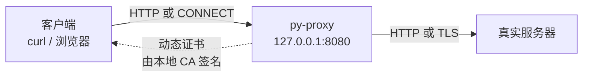
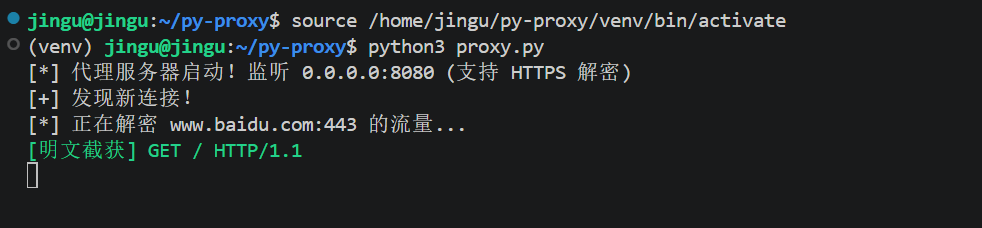
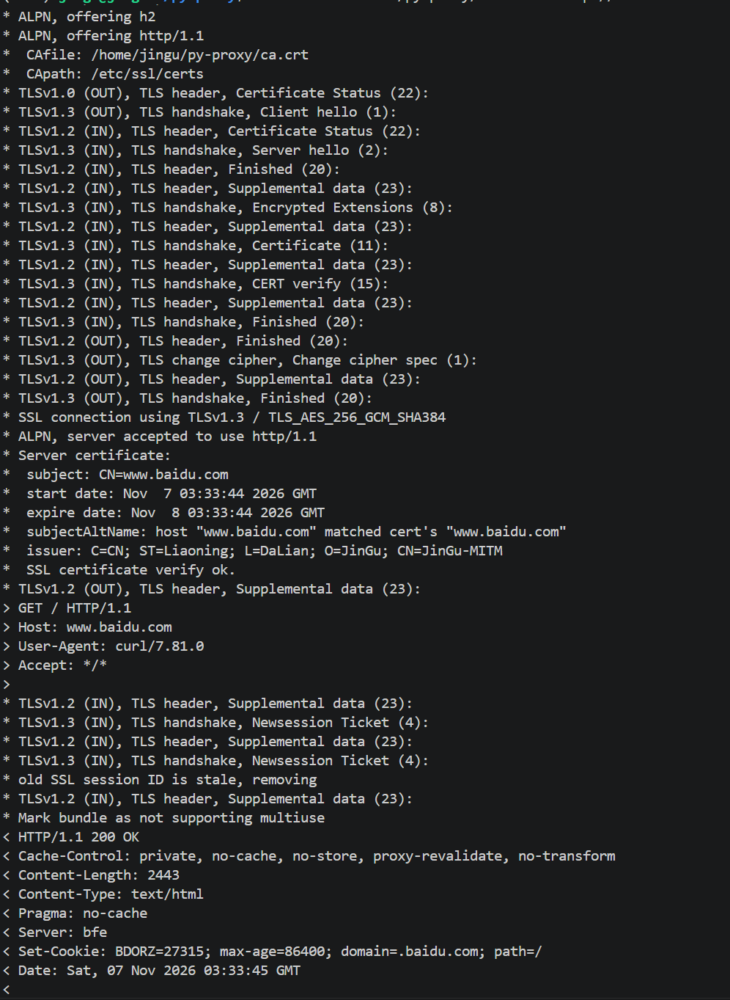
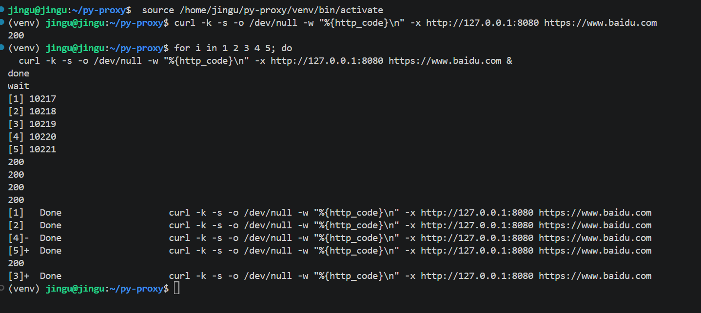

# py-proxy：HTTP/HTTPS MITM 代理

日期：2026-11-07

## 今天完成了什么

- 用 Python asyncio 实现普通 HTTP 代理：absolute-form 请求行改写成 origin-form，转发请求和响应，`Connection: close`。
- 实现 HTTPS MITM：处理 `CONNECT host:443` → 返回 200 → 动态签发证书 → 终止客户端 TLS → 以 TLS 客户端身份连接真实服务器。
- 按域名缓存证书：`certs/<domain>.crt` / `.key`，解决并发连接互相覆盖 `temp.crt` 的问题。
- 验证：
  - 单条 HTTPS：200
  - 5 条并发 HTTPS：全部 200
  - `--cacert ca.crt`：`SSL certificate verify ok`
- 补 README、`.gitignore`，推送 GitHub。

仓库：https://github.com/JinGu123123/py-proxy

## 架构



### HTTP 流程

1. 客户端把请求发给代理：`GET http://example.com/ HTTP/1.1`（absolute-form）。
2. 代理解析 URL，连接 `example.com:80`。
3. 代理把请求行改写为 `GET / HTTP/1.1`（origin-form），转发请求头，并加 `Connection: close`。
4. 代理把响应原样转发回客户端，然后关闭连接。

### HTTPS 流程

1. 客户端发送 `CONNECT example.com:443 HTTP/1.1`。
2. 代理返回 `200 Connection Established`。
3. 代理为 `example.com` 动态生成证书，由本地 CA 签名。
4. 代理与客户端完成 TLS 握手（客户端需要信任本地 CA）。
5. 代理以 TLS 客户端身份连接真实 `example.com:443`，校验证书。
6. 两个方向解密后的字节互相转发，代理可以打印明文请求。

## 关键概念

### HTTP 代理 vs HTTPS 代理

- **HTTP 代理**：客户端知道自己在用代理，请求行是 absolute-form（带完整 URL）。
- **HTTPS 代理**：客户端先发 `CONNECT`，之后以为自己在直接和服务器说话；TLS 里面是 origin-form（只有 `/`）。
- 这正是 Burp 能看懂 HTTPS 的原因：它在中间终止 TLS，拿到明文，再重新加密转发。

### 证书链

- 本地 CA：`ca.key` + `ca.crt`。
- 每个域名动态签发一张叶子证书：
  - `CN` / `SAN` = 域名
  - `BasicConstraints: ca=False`
  - `KeyUsage: digitalSignature, keyEncipherment`
  - `ExtendedKeyUsage: serverAuth`
  - 有效期 1 天
- 客户端信任 `ca.crt` 后，才会接受代理伪造的证书。

### ALPN

- 代理只提供 `http/1.1`，所以即使客户端支持 h2，最后也会协商成 `http/1.1`。
- 这样代理才能按 HTTP/1.1 解析和打印明文。

### 抓包对比

- Wireshark 看到的是 `TLSv1.3 Application Data`，看不到 `GET / HTTP/1.1`。
- 代理终端能看到明文请求。
- 原因：TLS 只保护“路上”的流量；MITM 代理持有被信任的 CA 私钥，在中间终止了 TLS。







## 踩坑记录

- `'StreamReader' object has no attribute 'protocol'`：`StreamReader` 没有公开的 `protocol` 属性，`start_tls` 要用 `client_writer._protocol`。
- CONNECT 的请求头没读完：只读了第一行就发 200，后面的 `Host` / `Proxy-Connection` 会混进 TLS；要读到空行。
- 回源用明文 TCP 连 443：真实服务器期待 TLS ClientHello；必须 `ssl=remote_ctx, server_hostname=host`。
- `temp.crt` / `temp.key` 并发覆盖：浏览器会同时开很多 HTTPS 连接；改成按域名生成 `certs/<domain>.crt` / `.key` 并缓存。
- `Connection refused`：代理没启动；VS Code 终端里要开两个终端，一个跑代理，一个测试。
- `neverssl.com` 超时：不一定是代理问题；先用 `curl -4 -I http://www.baidu.com` 确认虚拟机网络。
- `.gitignore` 必须覆盖 `ca.key`、`*.crt`、`*.key`、`*.pcap`、`certs/`、`venv/`、`__pycache__/`。

## 验证命令

```bash
# 普通 HTTP
curl -x http://127.0.0.1:8080 http://www.baidu.com

# HTTPS，跳过证书校验
curl -k -x http://127.0.0.1:8080 https://www.baidu.com

# HTTPS，信任本地 CA（验证证书链和主机名）
curl --cacert ca.crt -x http://127.0.0.1:8080 https://www.baidu.com

# 并发测试
for i in 1 2 3 4 5; do
  curl -k -s -o /dev/null -w "%{http_code}\n" \
    -x http://127.0.0.1:8080 https://www.baidu.com &
done
wait
```

## 下一步

- README 加一张终端演示截图。
- 响应状态行日志、POST body / chunked / keep-alive。
- 浏览器实测（先修好证书缓存，导入实验浏览器 CA）。
- 进入 mini-IDS 深挖：规则化、离线 pcap、告警、误报分析。
